# Malware Technical Report: Two-Stage Dropper & Defense Evasion via MpSigStub Masquerading

## Sample Identification & Metadata
* **Original Dropper File Name:** `mpam-d_bd_1.383.1786.0.exe`
* **Extracted Stage-2 Payload Name:** `MpSigStub.exe`
* **File Type:** PE32+ executable (GUI) x86-64
* **MD5:** `0b1bee0c97f12bfef4e21013854c0ac`
* **SHA-1:** `dd06a7dadd785db1882bfed42cc02ba3bf72d8a`
* **SHA-256:** `c3e6c682ffc9521efeac722d77abbfb886d36d964ea83e8ee0ad10b51172c0a`
* **File Size:** 625.49 KB (640,504 bytes)
* **Compiler / Toolchain:** Microsoft Visual C/C++ (19.28.30095) [LTCG/C++] / Visual Studio 2019

## Executive Summary
This report provides a detailed technical reverse engineering analysis of a two-stage Windows x64 malware campaign. The initial binary acts as a custom dropper/extractor that extracts an embedded cabinet payload (CAB) into the `%TEMP%` directory and executes a second-stage executable (`MpSigStub.exe`).

The dropped component masquerades as Microsoft’s legitimate Defender signature update utility (`MpSigStub.exe`). Its primary objectives are anti-analysis reconnaissance, bypassing Windows Security mechanisms via Group Policy injection (`HKLM\SOFTWARE\Policies\Microsoft\Windows Defender`), inspecting active security services, and evading detection before performing a clean exit. Both stages employ SEH-based anti-debugging routines (`IsDebuggerPresent` / `NtQueryInformationProcess`) which were successfully neutralized through binary patching.

---

## Binary Technical Specifications
* **Architecture:** PE32+ (64-bit Executable)
* **Subsystem:** Windows GUI
* **Primary Capabilities:** Dropper/Extractor, Defense Evasion, Group Policy Manipulation, Security Reconnaissance, Anti-Debugging
* **Toolchain Used:** PE-bear, x64dbg, IDA Pro, Process Monitor (Sysinternals), HxD Hex Editor

---

## Technical Walkthrough

### 1. Static Triage & Import Inspection
Initial static inspection using **VirusTotal** showed **0/73** detections, indicating that the sample effectively evades generic signature-based detection mechanisms.

#### Dropper (`mpam-d_bd_1.383.1786.0.exe`):
* **Entropy & Packing:** Disk size aligns with virtual memory footprint across PE section headers (`.text`, `.rdata`, `.data`, `.pdata`, `.rsrc`, `.reloc`), confirming no external packer is used.
* **Import Address Table (IAT):**
  * `ADVAPI32.dll`: Key privilege management (`OpenProcessToken`, `AdjustTokenPrivileges`) and Registry functions (`RegCreateKeyExW`, `RegSetValueExW`).
  * `KERNEL32.dll`: File I/O (`CreateFileW`, `WriteFile`), process management (`CreateProcessW`, `OpenProcess`), and environment queries.
  * `ntdll.dll`: Native API calls (`NtQueryInformationProcess`).
* **Dynamic API Resolution:** Extracted ASCII strings revealed explicit dynamic loading references for `cabinet.dll`, `mscoree.dll`, and `kernelbase.dll`.

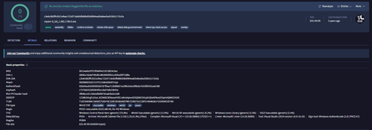
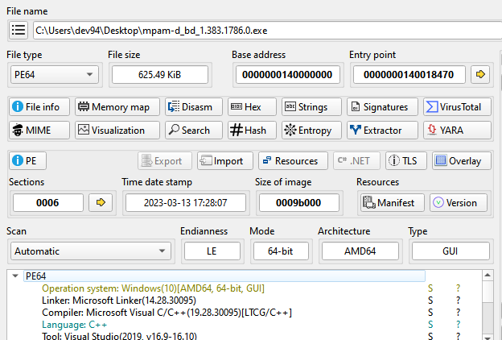
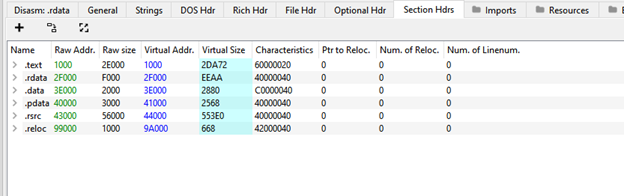
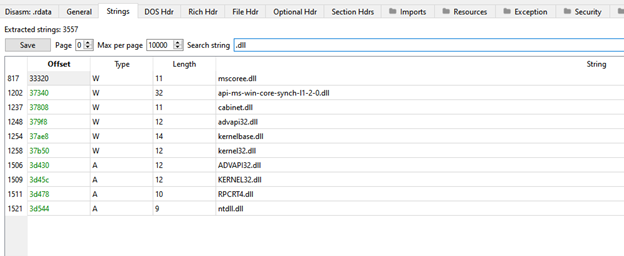

---

### 2. Payload Extraction Mechanism (Cabinet/Dropper Analysis)
Deep disassembly in **IDA Pro** uncovered the internal routine (`sub_14000A448`) responsible for extracting the stage-2 payload:
1. **Dynamic Module Loading:** The binary dynamically calls `LoadLibraryExW` to load `cabinet.dll` and resolves `FDICreate`, `FDICopy`, and `FDIDestroy` via `GetProcAddress`.
2. **Callback-Based Decompression:** During `FDICopy` execution, callback function `sub_14000A6F0` is invoked to reconstruct and write the compressed payload onto the disk under the `%TEMP%` path using the `%s\\%p` formatting string pattern.
3. **Trace Cleanup:** After payload decompression, `FreeLibrary` is called on `cabinet.dll` to unload the DLL and minimize memory artifacts.

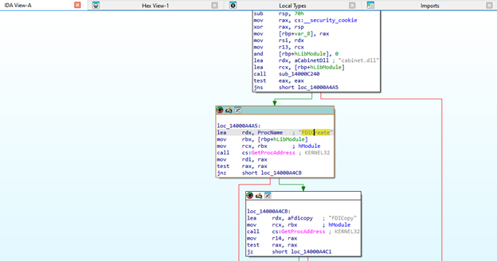
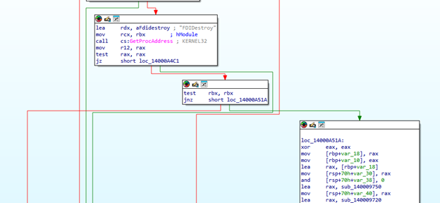

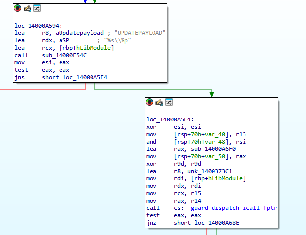

---

### 3. Stealth Process Execution & Persistence
In routine `sub_14000C6A4`, the dropper invokes `CreateProcessW` to execute the extracted executable:
* **Stealth Execution:** The `dwCreationFlags` parameter is explicitly set to `0x08000000` (`CREATE_NO_WINDOW`), enforcing headless background execution without displaying any console or GUI window.
* **Persistence Mechanism:** Function `sub_14000F580` invokes `RegSetValueExW` to write configuration/autostart data to Windows Registry autorun keys.

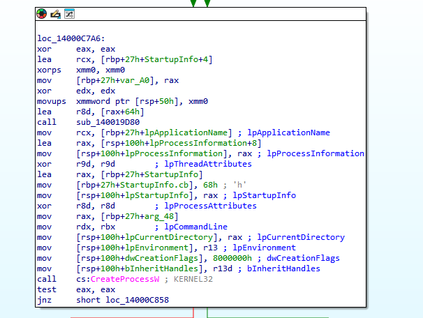
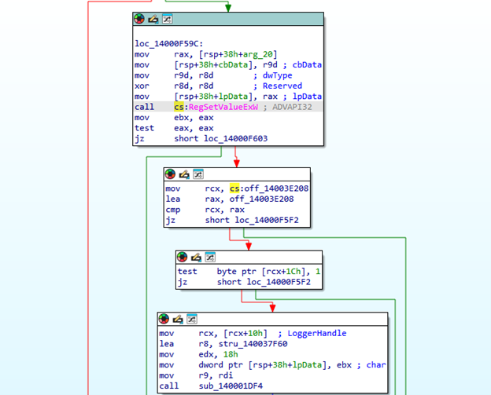

---

### 4. Anti-Debugging Analysis & Binary Patching
An anti-analysis routine was identified within `sub_140013B10`:
* **Detection Logic:** The binary calls `IsDebuggerPresent` and stores the boolean result in the `EDI` register. It then sets an exception filter via `SetUnhandledExceptionFilter`.
* **Conditional Branching:** The instruction `test edi, edi` followed by `jnz short loc_140013C44` causes the binary to immediately jump to an early termination block if a debugger is detected (`EDI != 0`).
* **Bypass Strategy:** The conditional jump instruction was statically patched by replacing the branching opcodes with **NOP (`0x90 0x90`)** instructions, forcing the execution flow into the main operational routine during dynamic tracing.

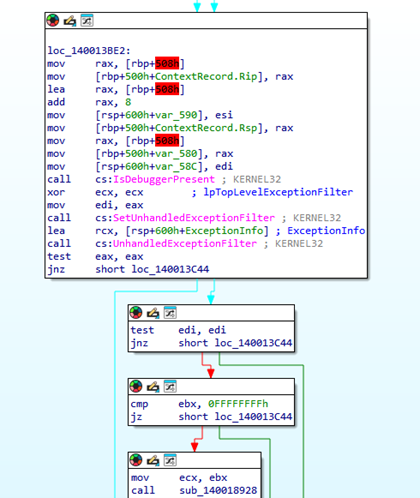
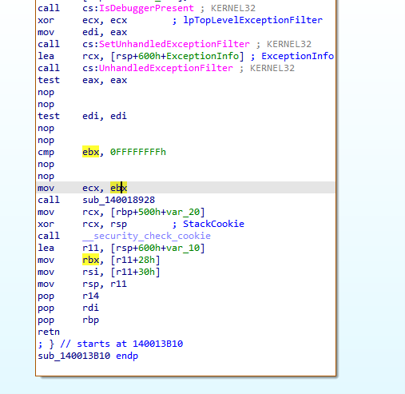

---

### 5. Stage-2 Analysis (`MpSigStub.exe`) & Dynamic Profiling
Tracing the execution in **x64dbg** confirmed the creation of the stage-2 payload under:
`C:\Users\dev94\AppData\Local\Temp\97E2494D-A661-43C1-B3B4-74FFBC1BDFCD\MpSigStub.exe`

#### Hex & Import Inspection:
* Header analysis in **HxD** verified standard PE format (`MZ` / `PE\0\0`).
* Extracted strings revealed target libraries: `mpengine.dll`, `mpclient.dll`, `mspatcha.dll`, `SenseUpdateProvision.dll`, and `gapaengine.dll`. These names correspond to Microsoft Defender and Windows Defender ATP (Sense Service) engines.

#### Security Reconnaissance & Defense Evasion:
* **Service Inspection:** Intercepted API calls to `OpenSCManagerW`, `OpenServiceW`, and `QueryServiceStatusEx` demonstrate that the malware enumerates security services to check whether anti-virus or endpoint protections are actively running.
* **Group Policy Manipulation:** Dynamic monitoring via **Process Monitor (Sysinternals)** captured write operations to:
  `HKLM\SOFTWARE\Policies\Microsoft\Windows Defender`
  This modification attempts to disable Windows Defender Real-Time Protection via administrative policy overrides.
* **Safe Mode & Policy Checks:** Queries to `HKLM\SYSTEM\CurrentControlSet\Control\SafeBoot\Option` and `HKLM\SOFTWARE\Policies\Microsoft\Windows\Safer\CodeIdentifiers` assess whether the target is in Safe Mode or restricted by Software Restriction Policies (SRP).
* **Logging Artifacts:** Execution progress is recorded in `C:\Windows\Temp\MpSigStub.log`.

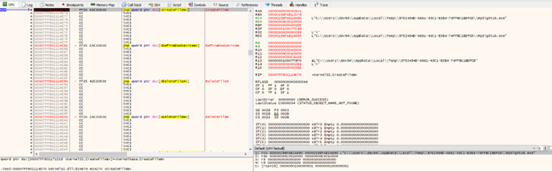
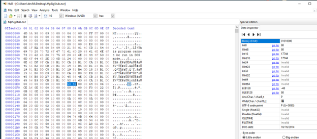
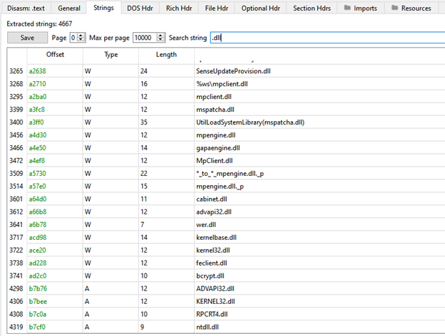
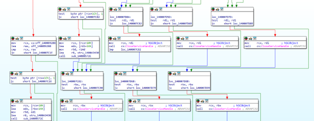
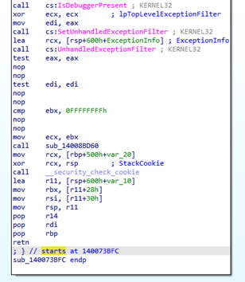
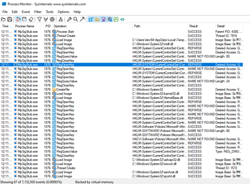
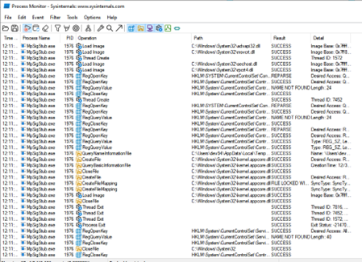
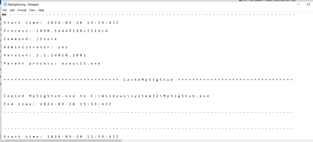
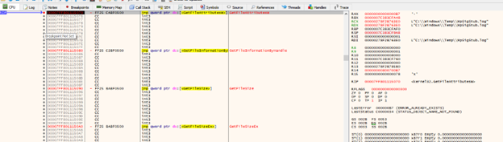
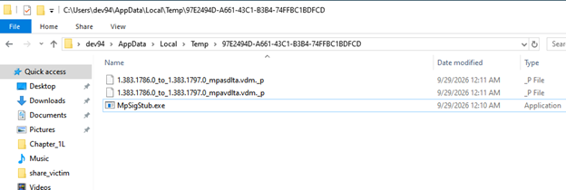

---

## Indicators of Compromise (IoCs)

### File Hashes
* **Dropper (`mpam-d_bd_1.383.1786.0.exe`):**
  * **MD5:** `0b1bee0c97f12bfef4e21013854c0ac`
  * **SHA-256:** `c3e6c682ffc9521efeac722d77abbfb886d36d964ea83e8ee0ad10b51172c0a`

### File System Artifacts
* `%TEMP%\97E2494D-A661-43C1-B3B4-74FFBC1BDFCD\MpSigStub.exe`
* `%TEMP%\97E2494D-A661-43C1-B3B4-74FFBC1BDFCD\1.383.1786.0_to_1.383.1797.0_mpasdlta.vdm._p`
* `%TEMP%\97E2494D-A661-43C1-B3B4-74FFBC1BDFCD\1.383.1786.0_to_1.383.1797.0_mpavdlta.vdm._p`
* `C:\Windows\Temp\MpSigStub.log`

### Registry Modification Keys
* `HKLM\SOFTWARE\Policies\Microsoft\Windows Defender`
* `HKLM\SYSTEM\CurrentControlSet\Control\SafeBoot\Option`
* `HKLM\SOFTWARE\Policies\Microsoft\Windows\Safer\CodeIdentifiers`

---

## Detection Signature (YARA)

```yara
rule Malware_DefenseEvasion_MpSigStub_Masquerade {
    meta:
        description = "Detects two-stage dropper abusing MpSigStub masquerading and Defender policy tampering"
        author = "Asif Ganbayev"
        date = "2026-10-08"
        sample_md5 = "0b1bee0c97f12bfef4e21013854c0ac"
        sample_sha256 = "c3e6c682ffc9521efeac722d77abbfb886d36d964ea83e8ee0ad10b51172c0a"

    strings:
        // Masqueraded components and internal targets
        $s1 = "SenseUpdateProvision.dll" wide ascii
        $s2 = "mpengine.dll" wide ascii
        $s3 = "UPDATEPAYLOAD" ascii
        $s4 = "MpSigStub.exe" wide ascii
        
        // Registry manipulation targets
        $reg1 = "SOFTWARE\\Policies\\Microsoft\\Windows Defender" wide ascii
        
        // Opcode pattern for IsDebuggerPresent check followed by exception handling
        $hex_anti_debug = { 48 8B ?? ?? ?? ?? ?? 48 83 C0 08 FF 15 ?? ?? ?? ?? 33 C9 }

    condition:
        uint16(0) == 0x5A4D and
        (
            (3 of ($s*)) or
            ($reg1 and 1 of ($s*)) or
            $hex_anti_debug
        )
}
```

### Note!!!
* This repository and the contained technical write-up are strictly created for educational, academic, and cybersecurity research purposes. The reverse engineering analysis was conducted in an isolated laboratory environment to understand threat behavior and develop detection mechanisms (YARA). No malicious binaries are hosted in this repository.