# Case Study: A Microsoft Defender Definition Update Misidentified as a Two-Stage Dropper

## Sample Identification & Metadata
* **File Name:** `mpam-d_bd_1.383.1786.0.exe`
* **Extracted Component:** `MpSigStub.exe`
* **File Type:** PE32+ executable (GUI) x86-64, Microsoft Visual C/C++ 19.28 / Visual Studio 2019
* **VersionInfo:** `CompanyName` Microsoft Corporation; `FileDescription` "AntiMalware Definition Update" (`MpSigStub.exe`: "Microsoft Malware Protection Signature Update Stub"); `StubName` AdlStub
* **Authenticode signer:** Microsoft Corporation, issued by Microsoft Code Signing PCA 2010 (both files)
* **VirusTotal:** 0/73 (see `images/1.png`)
* **Verdict:** **legitimate Microsoft Defender delta definition update (false positive)**

> **Revision (2026-11-06).** The first version of this repository described the sample as a malicious two-stage dropper that disables Microsoft Defender. Re-examination showed that both files are Microsoft-signed components of the Defender update mechanism and that every observed behaviour is the documented behaviour of that mechanism. The repository is kept as a false-positive case study. The previous YARA rule has been withdrawn because it matches a legitimate Microsoft file.

---

## What Was Observed
The original analysis recorded the following behaviour correctly:

1. The file loads `cabinet.dll`, resolves `FDICreate`, `FDICopy` and `FDIDestroy`, and extracts an embedded CAB archive (resource type `CABINET`, name `UPDATEPAYLOAD`) to `%TEMP%\<GUID>\`.
2. It starts the extracted `MpSigStub.exe` with `CreateProcessW` and `CREATE_NO_WINDOW`.
3. `MpSigStub.exe` queries security services (`OpenSCManagerW`, `OpenServiceW`, `QueryServiceStatusEx`), accesses `HKLM\SOFTWARE\Policies\Microsoft\Windows Defender`, `...\SafeBoot\Option` and `...\Safer\CodeIdentifiers`, and writes `C:\Windows\Temp\MpSigStub.log`.
4. The files referenced engine and delta files: `mpengine.dll`, `mpasdlta.vdm`, `mpavdlta.vdm`.

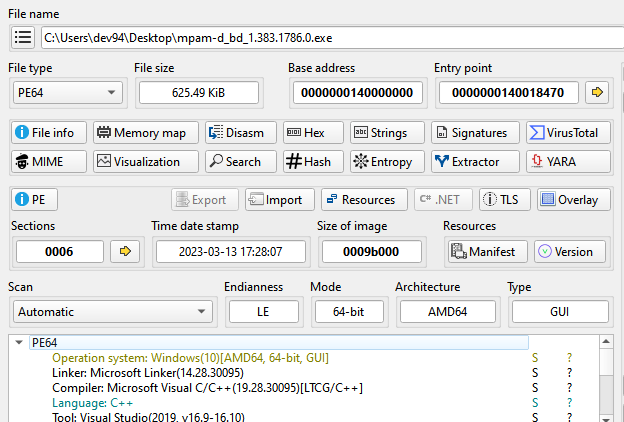
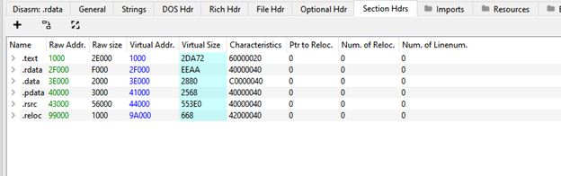
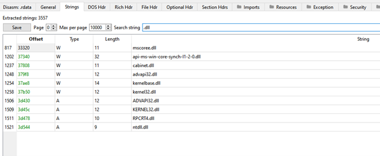
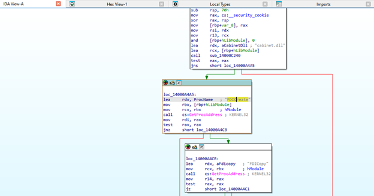
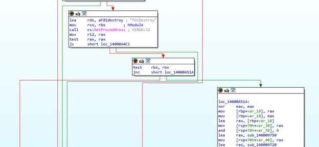

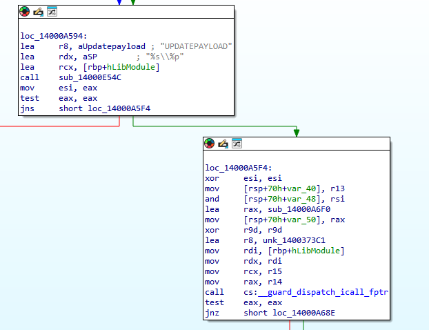
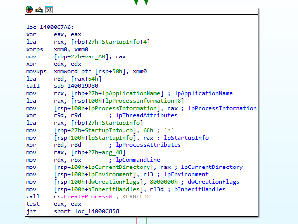
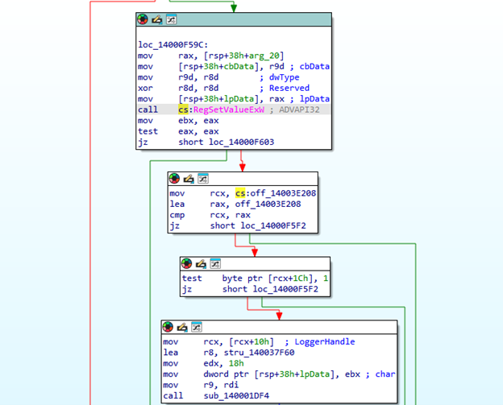

## Why It Is Not Malicious

### 1. Authenticode signature and VersionInfo
Both files carry an Authenticode signature by Microsoft Corporation (Microsoft Code Signing PCA 2010) and Microsoft version information describing them as Defender update components. `mpam-d.exe` is the name of the Defender definition update package, and `MpSigStub.exe` is its update stub.

Note: the copies stored in `Two-Stage Dropper & Defense Evasion.7z` were patched during the analysis (NOP patches), so their Authenticode digest no longer matches the signature. A digest mismatch can also mean third-party tampering, so the signature must be verified on an unmodified copy (`signtool verify /pa <file>` or the file's *Digital Signatures* tab).

### 2. The log file shows Windows Update running the same stub
`C:\Windows\Temp\MpSigStub.log` contains earlier runs of the same stub started by Windows Update (`wuauclt.exe`) for engine, platform and definition updates from `C:\Windows\SoftwareDistribution\Download\Install\`. The analysed file ran with the same command-line pattern (`/stub ... /payload ...`); the only difference is that it was started from the desktop.

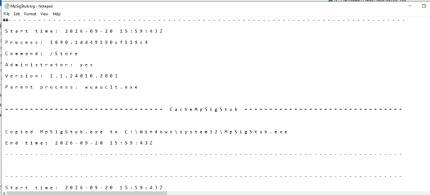

### 3. The registry activity is read-only
In Process Monitor, the accesses to `HKLM\SOFTWARE\Policies\Microsoft\Windows Defender` are `RegOpenKey` and `RegQueryValue` operations, mostly with the result `NAME NOT FOUND`. The stub checks whether an administrator has configured Defender through policy; it does not write the policy.

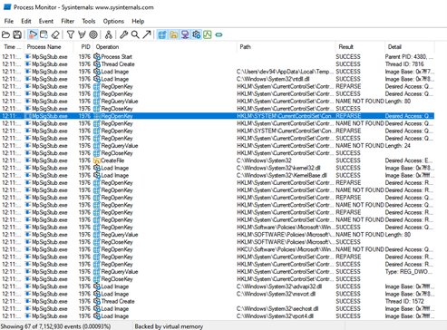
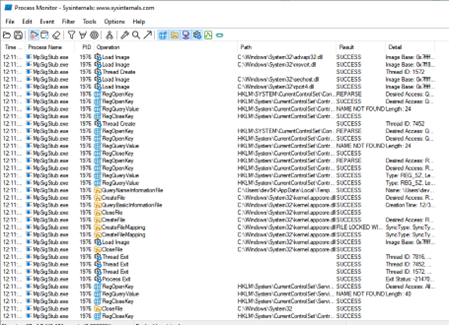

### 4. The `IsDebuggerPresent` block is MSVC runtime code
The sequence `IsDebuggerPresent` → `SetUnhandledExceptionFilter` → `test edi, edi` / `jnz` is the MSVC C runtime function `__scrt_fastfail`, present in almost every MSVC-built program. It runs only when the program fails fast and is not an anti-debugging check.

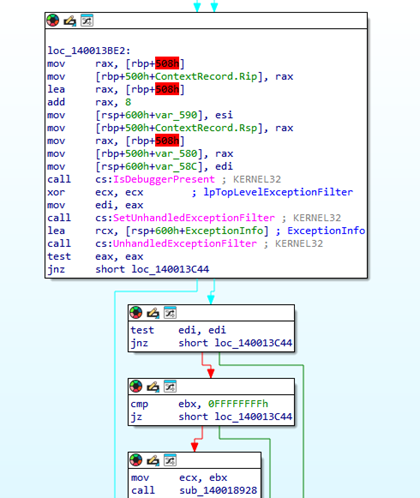
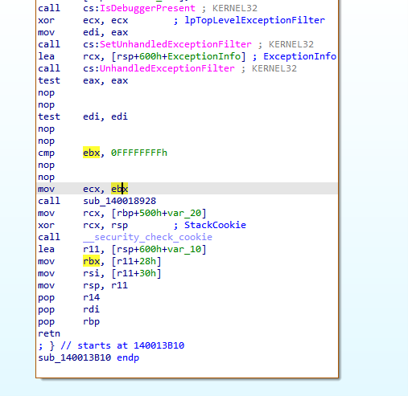

### Other screenshots from the original analysis
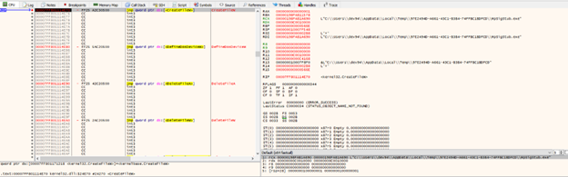
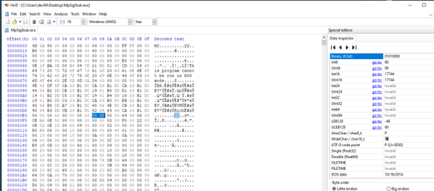
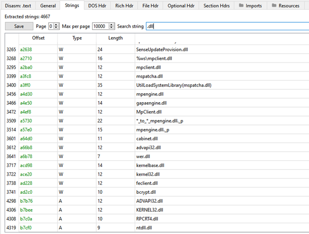
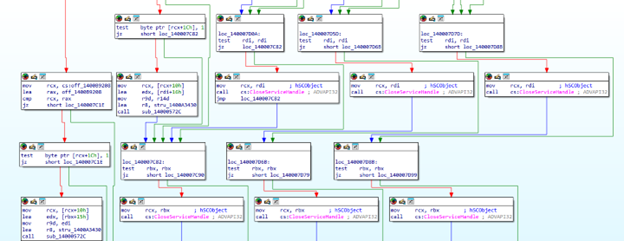
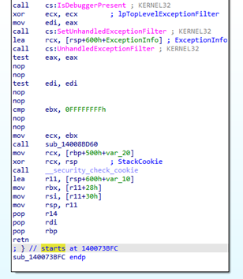
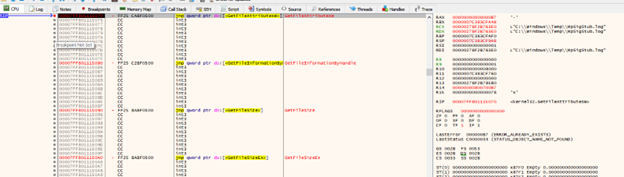
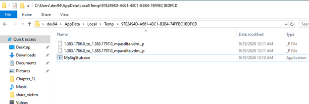

---

## Lessons
* Check the Authenticode signature and VersionInfo first; a valid signature by the vendor whose product the file claims to be is strong evidence.
* Compare the behaviour with the documented function of the product before calling it evasion: extracting a CAB to `%TEMP%` and starting `MpSigStub.exe` is exactly what a Defender update does.
* In Process Monitor, look at the operation type (`RegQueryValue` vs `RegSetValue`) and its result, not only at the key name.
* A detection of 0/73 is not proof of evasion; for signed vendor files it is the expected result.
* A signature does not prove that a file is benign (stolen certificates and abused signed binaries exist), but a "malicious" verdict against a valid vendor signature needs specific evidence.

## YARA
The rule `Malware_DefenseEvasion_MpSigStub_Masquerade` has been withdrawn: it matches the legitimate, Microsoft-signed `MpSigStub.exe` and would cause false positives on every Windows system that receives Defender updates.

### Note
This repository is for educational purposes. No malicious file is involved; the analysed files are Microsoft software.
